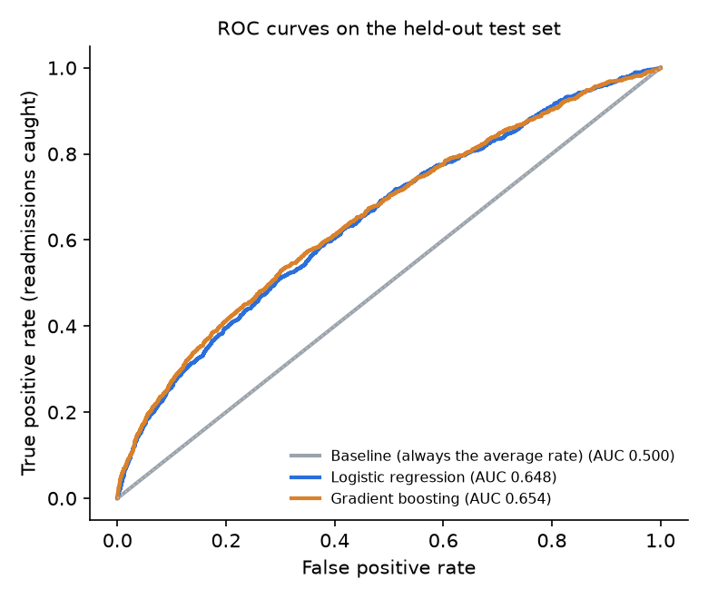
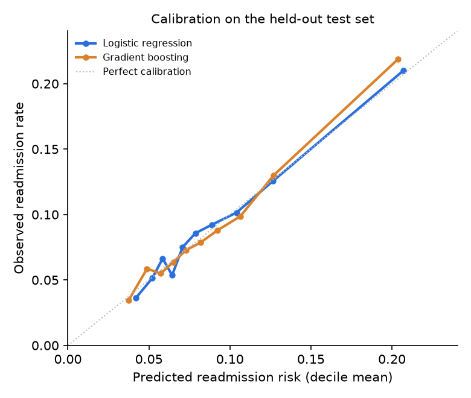

# readmission-predictor

Which diabetic patients come back to hospital within 30 days? This project cleans 101,766 hospital encounters with **pandas**, compares **scikit-learn** models with cross-validation, and checks the winner once on held-out patients: ranking, calibration and fairness across groups. A compact model runs as a risk calculator in the browser.

**Results page and calculator:** https://readmission-predictor.vercel.app · **Findings report:** [`results/FINDINGS.md`](results/FINDINGS.md)

[](https://github.com/Shreyashsalv2/readmission-predictor/actions/workflows/ci.yml)

## Results (13,998 held-out patients)
| Model | CV ROC-AUC (5-fold) | Test ROC-AUC | Test PR-AUC | Brier | Readmissions caught in the riskiest 10% |
|---|---|---|---|---|---|
| Baseline (always the average rate) | 0.500 | 0.500 | 0.090 | 0.0817 | 10% |
| Logistic regression | 0.645 ± 0.004 | 0.648 | 0.169 | 0.0793 | 23% |
| **Gradient boosting** | 0.655 ± 0.006 | **0.654** (95% CI 0.639-0.670) | 0.186 | 0.0787 | 24% |

- 69,987 patients after cleaning; 9.0% were readmitted within 30 days.
- Flagging the riskiest 10% catches 24% of readmissions, 2.4x the average rate. Both models are well calibrated (see the calibration plot).
- Readmission rate is 8.1% with no inpatient stay in the prior year and 29.3% with 4 or more; 20.6% for patients discharged to rehab or another hospital vs 6.9% for those sent home.
- The honest conclusion: these administrative records rank risk better than chance but modestly. Good enough to prioritise follow-up calls, not to make individual care decisions.

 

## How it works
1. **Clean** (`readmit/data.py`, pandas): '?' read as missing; 'None' lab results kept as *not measured*; expired and hospice discharges removed; one encounter per patient (the first) so no patient is in both training and test data; ICD-9 codes grouped into 9 disease groups; specialties capped at the top 10; weight (about 97% missing), payer code and constant columns dropped.
2. **Explore**: readmission rates by prior visits, age, HbA1c testing and discharge destination (`results/eda_*.png`).
3. **Model** (`readmit/models.py`, scikit-learn): one-hot encoding + scaling in a `ColumnTransformer`, then a prior-only baseline, logistic regression (C chosen by cross-validation) and histogram gradient boosting.
4. **Evaluate** (`readmit/evaluate.py`): stratified 5-fold CV on 55,989 training patients picks the model; the 13,998-patient test set is used once. ROC-AUC with a bootstrap 95% CI, PR-AUC (only 9.0% positives), Brier score, calibration by decile, catch rate in the top 10%, and ROC-AUC and calibration by age, gender and race.
5. **Explain**: logistic-regression odds ratios; discharge destination dominates.
6. **Calculator**: a compact logistic regression on 13 inputs (test ROC-AUC 0.645) is exported to JSON and scored in JavaScript (`site/calculator.js`). Tests check the JavaScript and Python scorers match scikit-learn to 12 decimal places.

## Run it
```bash
pip install -r requirements.txt
scripts/get_data.sh data                     # downloads from UCI and checks a pinned SHA-256
pytest -q
python scripts/run_pipeline.py --data data/diabetic_data.csv --out results --site site
python scripts/write_findings.py && python scripts/build_site.py
```

## Tests and CI
`pytest` runs on a synthetic dataset with the real file's columns and quirks (cleaning rules, ICD-9 grouping, one row per patient, model sanity, JSON export, the JavaScript calculator in Node) plus checks on the real file when it has been downloaded. GitHub Actions downloads the dataset from UCI, runs the tests and the full pipeline, fails if the best test ROC-AUC drops below 0.62, and checks that a fresh run reproduces the committed results.

## Limits
Data from 1999-2008 US hospitals; administrative fields only (no social factors, follow-up care or most lab values); one encounter per patient discards repeat-visit history beyond the visit counts. The calculator is a demonstration, **not a clinical tool**.

## Data
Strack, B. et al. (2014). *Impact of HbA1c Measurement on Hospital Readmission Rates: Analysis of 70,000 Clinical Database Patient Records.* BioMed Research International. Diabetes 130-US Hospitals for Years 1999-2008, UCI Machine Learning Repository, CC BY 4.0. The data is downloaded at run time and not stored in this repository.

## License
MIT (code).
